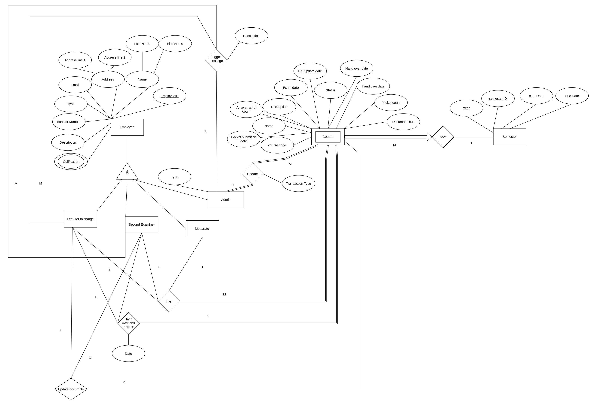
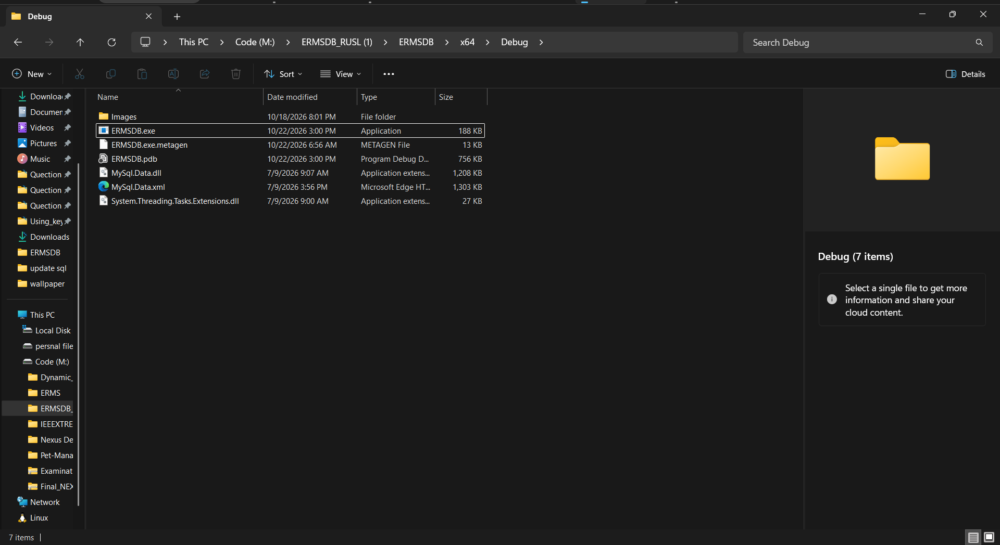
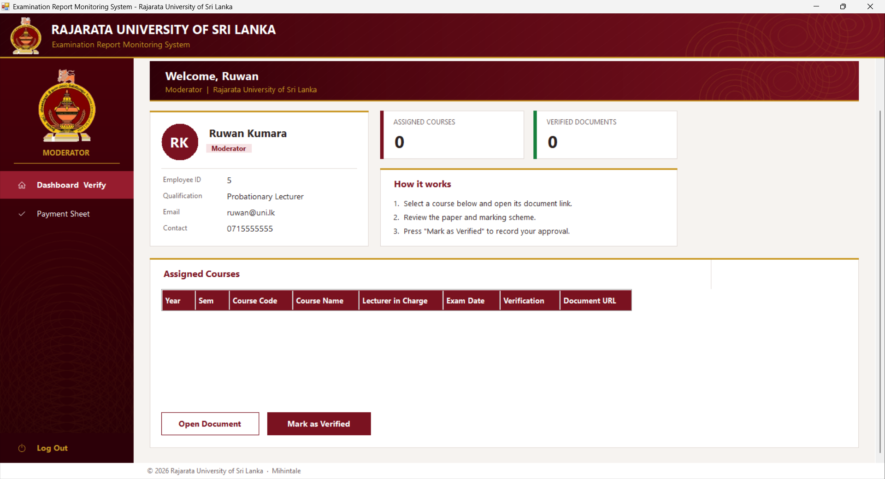
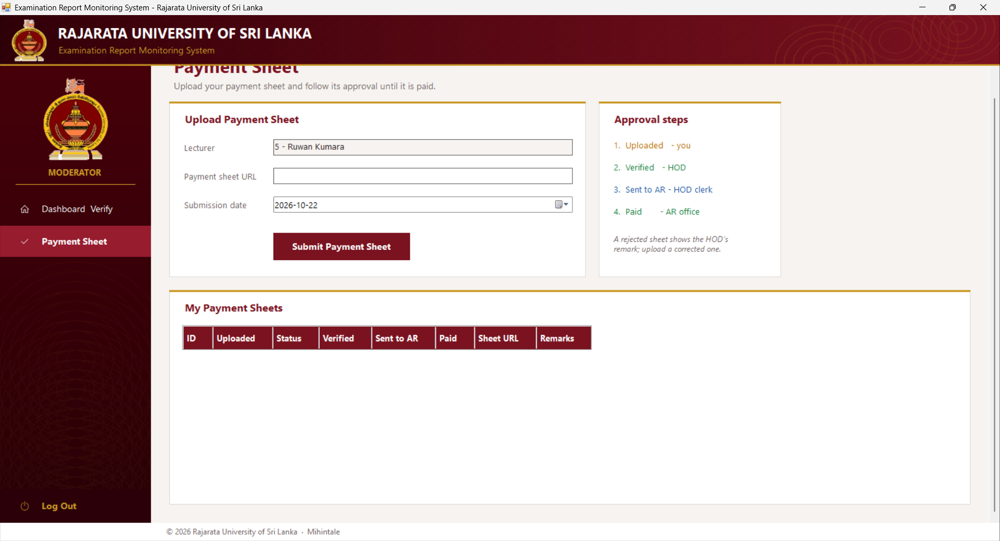
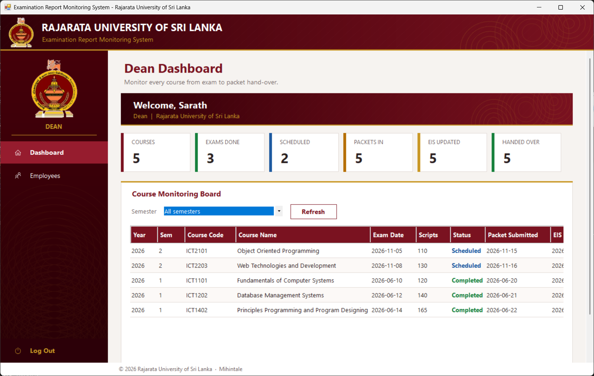
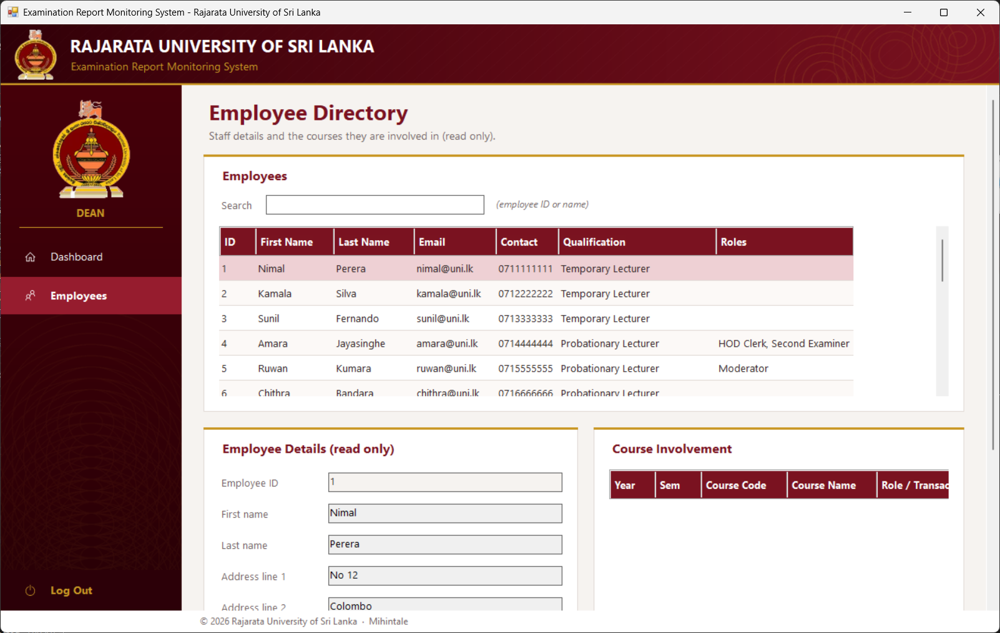

# ERMS - Examination Report Monitoring System
**Rajarata University of Sri Lanka**

A Windows desktop application (Visual Studio, C++/CLI Windows Forms) connected to a MySQL database named `ERMS`.
It follows an exam from the exam paper to the payment of the lecturer, and gives every role its own interface.

<p align="center">
  
</p>

---

## Contents
1. [What you need](#1-what-you-need)
2. [Set up the database (MySQL)](#2-set-up-the-database-mysql)
3. [Configure the database connection](#3-configure-the-database-connection)
4. [Open, build and run the project](#4-open-build-and-run-the-project)
5. [Sign in (demo accounts)](#5-sign-in-demo-accounts)
6. [What each role can do](#6-what-each-role-can-do)
7. [Business rules](#7-business-rules)
8. [Project structure](#8-project-structure)
9. [Database design (ER diagram)](#9-database-design-er-diagram)
10. [User guide - log on and manage the system](#10-user-guide---log-on-and-manage-the-system)

---

## 1. What you need

| Requirement | Notes |
|---|---|
| Windows 10 / 11 (64-bit) | The side-menu icons use the *Segoe MDL2 Assets* font that ships with Windows 10/11. |
| Visual Studio 2022 or newer | Install the workloads **Desktop development with C++** and **.NET desktop development**. In the *Individual components* tab also tick **C++/CLI support for build tools** (matching your toolset version). |
| .NET Framework 4.x | Installed with Windows / Visual Studio. |
| MySQL Server 8.x (or 5.7) | With MySQL Workbench or any MySQL client to run the SQL scripts. |
| **MySql.Data.dll** | MySQL Connector/NET (`MySql.Data.dll`, .NET Framework build). Download from the MySQL website or copy it from your old project. |

---

## 2. Set up the database (MySQL)

1. Start the MySQL server and open **MySQL Workbench** (or the `mysql` command line).
2. Connect as `root` (password used by this project: **`1234`**).
3. Run the scripts in this order:

| Order | File | Purpose |
|---|---|---|
| 1 | `ERMS.sql` | Creates the `ERMS` database, all tables and the sample data. **Warning:** the first line is `DROP DATABASE ERMS;`, so it erases an existing `ERMS` database. Change it to `DROP DATABASE IF EXISTS ERMS;` if the database does not exist yet. |
| 2 | `ERMS_demo_assignments.sql` *(optional)* | Gives the lecturer, second examiner and moderator demo accounts some courses to show. |
| 3 | `ERMS_update.sql` *(optional)* | Creates the payment-sheet and extra-document tables. **Not required:** the application creates these tables by itself the first time someone signs in. |

**Run a script in Workbench:** *File > Open SQL Script...* > choose the file > click the lightning-bolt button (**Execute**).

**Check it worked:** run `SHOW TABLES;` on the `ERMS` database. You should see `Employee`, `Course`, `Semester`, `Users`, `Admin`, `Admin_Course` and the other tables.

> **Tables created by the program:** `Exam_Document` (lecturer mark sheet, second examiner report) and `Payment_Sheet` (payment workflow). The program also adds a demo **HOD clerk** (Employee ID 19).

---

## 3. Configure the database connection

All database settings are in **one place**: `ERMSDB/Db.h`

```cpp
literal String^ ConnStr = L"Server=localhost;Port=3306;Database=ERMS;Uid=root;Pwd=1234;";
```

| Setting | Meaning | Change it when... |
|---|---|---|
| `Server` | Computer running MySQL | MySQL is on another machine (use its name or IP address). |
| `Port` | MySQL port | Your MySQL does not use `3306`. |
| `Database` | Database name | You created the database with a different name. |
| `Uid` | MySQL user | You do not use `root`. |
| `Pwd` | MySQL password | Your password is not `1234`. |

Examples:

```cpp
// MySQL on another PC, user "erms_app"
L"Server=192.168.1.20;Port=3306;Database=ERMS;Uid=erms_app;Pwd=MyStrongPass;"

// MySQL 8 shows an authentication / "RSA public key" error:
L"Server=localhost;Port=3306;Database=ERMS;Uid=root;Pwd=1234;AllowPublicKeyRetrieval=true;"
```

After editing `Db.h`, **rebuild** the project (section 4).

### Point the project to MySql.Data.dll
The project references `MySql.Data.dll`. On a new computer the path is usually wrong:

1. In **Solution Explorer** expand project **ERMSDB > References**.
2. Right-click **MySql.Data** > **Remove**.
3. Right-click **References** > **Add Reference... > Browse...** > select your `MySql.Data.dll` > **OK**.

---

## 4. Open, build and run the project

1. **Copy the project to a local drive** such as `C:\Projects\ERMSDB_RUSL` (avoid network, removable or very long paths).
2. Double-click **`ERMSDB.slnx`** to open it in Visual Studio. If asked to retarget the project, accept.
3. In the toolbar choose **Debug** and **x64**.
4. Fix the `MySql.Data` reference if needed (section 3).
5. Menu **Build > Rebuild Solution**. Wait for *Rebuild All: 1 succeeded*.
6. Press **F5** (or the green **Local Windows Debugger** button) to run.

The images (crest, login picture, header) are loaded from the `assets` folder and copied automatically to `<output>\Images` after each build.

### Run without Visual Studio
After a build, run `x64\Debug\ERMSDB.exe`. To give it to another computer, copy the **whole** `x64\Debug` folder (including the `Images` folder and `MySql.Data.dll`). That computer needs the .NET Framework 4.x and the Visual C++ Redistributable.

---

## 5. Sign in (demo accounts)

Sign in with **Employee ID** and **password** (from the `Users` table).

| Employee ID | Password | Opens |
|---|---|---|
| 7 | `lic123` | Lecturer in Charge |
| 4 | `sec123` | Second Examiner |
| 5 | `mod123` | Moderator |
| 13 | `hod123` | HOD |
| 10 | `dean123` | Dean |
| 1 | `ar123` | AR Office |
| 19 | `clerk123` | HOD Clerk (created automatically) |

Each login opens exactly **one** interface. If an employee holds several roles, the highest one wins:
Dean > HOD > Second Examiner > Moderator > Lecturer in Charge > HOD Clerk. A login with none of these roles opens the AR Office.

> Passwords are stored as plain text in the sample database. Use hashed passwords before real use.

---

## 6. What each role can do

| Role | Screens |
|---|---|
| **Lecturer in Charge** | Dashboard (select courses, nominate second examiner and moderator) - Document Submission (exam paper link, detail mark sheet) - Tracking - Payment Sheet |
| **Second Examiner** | View (assigned courses) - Document Submission (second examiner report, open the mark sheet) - Tracking - Payment Sheet |
| **Moderator** | Dashboard and Verify (open the document, mark as verified) - Payment Sheet |
| **HOD** | Dashboard (create semesters, add employees) - Course Tracking (add / update / delete) - Employees (update / delete) - Payment Sheets (verify or reject) |
| **HOD Clerk** | View Payment Sheets (send HOD-verified sheets to the AR office) |
| **AR Office** | Exam Packets (add courses and exams, collect packets, EIS update, hand over) - Payment Sheets (open sheet, mark as paid) |
| **Dean** | Dashboard (faculty-wide monitoring with filters) - Employees (read only) |

### Exam packet stages
`Pending` > `Packet submitted` > `EIS updated` > `Handed over`

### Payment sheet workflow
Lecturer **uploads** > HOD **verifies** (or rejects) > HOD Clerk **sends to AR** > AR Office marks **Paid**

---

## 7. Business rules

- A lecturer in charge can select **at most 4 courses** in total (0-4). A message appears when the maximum is reached.
- The **second examiner must hold a higher grade** than the lecturer in charge:
  Temporary Lecturer < Probationary Lecturer < Temporary Senior Lecturer < Senior Lecturer Grade 2 < Senior Lecturer Grade 1 < Professor.
  The grade is read from the employee's qualification.
- Packets must be **collected** before the EIS update or hand over; the hand-over date cannot be earlier than the collect date.
- New employee IDs are generated by the database (`AUTO_INCREMENT`).
- Document and payment links must start with `http://` or `https://`.

---

## 8. Project structure

```
ERMSDB_RUSL/
  ERMSDB.slnx                 Visual Studio solution
  ERMS.sql                    Database + sample data
  ERMS_demo_assignments.sql   Optional demo course assignments
  ERMS_update.sql             Optional (tables are created automatically)
  assets/                     Images: crest, login picture, header, sidebar
  docs/                       ER diagram, promotional poster, guide screenshots (docs/images)
  ERMSDB/
    ERMSDB.vcxproj            Project file
    Program.cpp               Entry point (login -> main window)
    Db.h                      MySQL connection string, queries, login, roles   <-- edit ConnStr here
    Theme.h                   RUSL colours, fonts and UI helpers
    BasePage.h                Base class of every screen
    LOGING.h                  Sign-in window
    MainShell.h               Main window (header, role menu, footer)
    LecturerDashBord.h  docup.h  TrakingDetails.h  PaymentSheetUpload.h
    secondExaminer.h  secondExaminerDocument.h  secondExaminerTraking.h
    ModaretorDashBord.h
    HODDashBord.h  HODDocument.h  HODTraking.h  HODPayment.h  HODclark.h
    DEANDASHBORD1.h  DEANTRAKING.h
    AROFFICE.h  ARPayment.h
```

**Real campus photo on the login page:** put a file named `campus.jpg` in `assets\` and rebuild.

---

## 9. Database design (ER diagram)

### 9.1 Original ER diagram

<p align="center">
  
</p>

> **Image slot:** `docs/ERMS_ER.jpg` (replace this file if the diagram changes)

### 9.2 How to read the diagram

| Item in the diagram | Meaning |
|---|---|
| **Employee** | Every staff member: `EmployeeID` (key), *Name* (first, last), *Address* (line 1, line 2), email, contact number, type, description and the multi-valued *Qualification*. |
| **ISA** (triangle) | An employee can be a **Lecturer in Charge**, **Second Examiner**, **Moderator** or **Admin** (Dean, HOD, HOD Clerk). |
| **Course** (double box) | Depends on a semester (weak entity). Attributes: course code, name, description, exam date, status, answer script count, packet submission date, EIS update date, hand over date, packet count and document URL. |
| **Semester** | `Year` + `semester ID` (key), start date, due date. |
| **have** | One semester has many courses (1 : M). |
| **has** | Lecturer in Charge, Second Examiner and Moderator are linked to the courses they work on. |
| **Update** | An Admin updates a course; the *Transaction Type* records what was done (1 : M). |
| **Hand over and collect** | Records the *Date* when exam packets are collected and handed over. |
| **Update documents** | The lecturer in charge and second examiner update the course documents. |
| **trigger message** | A message sent from the admin side to the lecturers. |

### 9.3 How the diagram became MySQL tables

| ER diagram | MySQL table(s) | Notes |
|---|---|---|
| Employee | `Employee` | `Employee_ID` is `AUTO_INCREMENT`. |
| Qualification (multi-valued) | `Employee_Qualification` | One row per qualification. |
| ISA: Lecturer in Charge / Second Examiner / Moderator | `Lecturer_in_Charge`, `Second_Examiner`, `Moderator` | Each holds the `Employee_ID` of people with that role. |
| ISA: Admin and employee type | `Admin`, `Employee_Type` | Types: Dean, HOD, HOD Clerk. |
| Semester | `Semester` | Key: (`Year`, `Semester_ID`). |
| Course (basic data) | `Course` | Code, name, description. |
| Course (exam data) | `Exam_Offering` | Exam date, answer script count, status per semester. |
| Course (packet data) | `Exam_Packet_Tracking` | Submission, EIS update and hand over dates, packet count, document URL. |
| has / Update | `Admin_Course` | Links an employee to a course in a semester. `Transaction_Type` stores the role or action (*Lecturer in Charge*, *Second Examiner*, *Moderator*, *Moderator - Verified*, ...). |
| Hand over and collect | `Hand_Over` | Employee, course and date. |
| Login | `Users` | Employee ID and password. |

**Added after the original diagram** (created automatically by the program):

| Table | Purpose |
|---|---|
| `Exam_Document` | Detail mark sheet link (lecturer) and second examiner report link, per course. |
| `Payment_Sheet` | Payment sheet workflow: Uploaded > Verified > Sent to AR > Paid (or Rejected). |

The *trigger message* relationship is not stored in a table; the program shows on-screen messages instead (for example when the 4-course limit is reached).


## 10. User guide - log on and manage the system

### 10.1 Log on and log out

**Step 1 - Start the program**

Run **ERMSDB** from Visual Studio (**F5**) or open `ERMSDB.exe`. The sign-in window opens. Make sure MySQL is running first.

Path: `C:\ERMSDB_RUSL (1)\ERMSDB\x64\Debug\ERMSDB.exe`


---

**Step 2 - Enter your Employee ID and password**

Type your **Employee ID** (a number) and **password**, then click **SIGN IN** (or press **Enter**). Tick *Show password* to check what you typed.


---

**Step 3 - Find your way around the main window**

The **header** shows your name and role, the **left menu** lists the screens of your role, the **middle** is the work area and the **footer** shows the database connection.



---

**Step 4 - Log out**

Click **Log Out** at the bottom of the left menu. You return to the sign-in window and can sign in as another user.

---

### 10.2 Lecturer in Charge (example login: 7 / lic123)

**Step 1 - Open the Dashboard**

After sign-in you see your profile and the course counter (for example `3 / 4`, maximum 4 courses).


---

**Step 2 - Select a course**

Choose the **Semester** and **Course**. Optionally pick a **Second Examiner** (only people of a higher grade are listed) and a **Moderator**. Click **Save Selection**. A message appears when you reach the maximum of 4 courses.


---

**Step 3 - Remove a course**

In **My Courses** click a row, then **Remove Selected Course** to free a place.


---

**Step 4 - Submit documents**

Open **Document Submission**. Pick the course, paste the **exam paper link** and click **Submit Paper**. Paste the **detail mark sheet link** and click **Submit Mark Sheet**. Links must start with `http://` or `https://`.


---

**Step 5 - Follow the packet**

Open **Tracking** to see each course move through *Pending > Packet submitted > EIS updated > Handed over*.


---

**Step 6 - Upload a payment sheet**

Open **Payment Sheet**, paste the link, check the date and click **Submit Payment Sheet**. The table shows its status: *Uploaded > Verified > Sent to AR > Paid* (or *Rejected* with a remark).


---

### 10.3 Second Examiner (example login: 4 / sec123)

**Step 1 - View your courses**

**View** lists the courses where you are second examiner, with the lecturer in charge and the exam date. Select a course and click **Open Document** to read the paper.


---

**Step 2 - Submit the second examiner report**

Open **Document Submission**. Pick the course. Under *Lecturer in Charge - Detail Mark Sheet* click **Open File** to read the mark sheet. Then paste your report link, choose the date and click **Submit Report**.


---

**Step 3 - Track progress**

**Tracking** shows the packet stage of your courses.


---

**Step 4 - Submit payment sheet**

Upload and manage payment sheets as a second examiner.


---

### 10.4 Moderator (example login: 5 / mod123)

**Step 1 - Verify a document**

Open **Dashboard & Verify**. Select a course, click **Open Document** to review it, then **Mark as Verified**. The *Verification* column changes to *Verified*.



---

**Step 2 - Payment Sheet**

Check payment processing status for moderation duties.



---

### 10.5 HOD (example login: 13 / hod123)

**Step 1 - Create a semester**

On the **Dashboard** enter the year, semester number, start and due dates and click **Create Semester**.


---

**Step 2 - Add an employee**

Fill in the details, choose the **Role** and the **Qualification** (grade), set a **login password** and click **Add Employee**. The Employee ID is generated automatically.


---

**Step 3 - Manage course tracking records**

Open **Course Tracking**. Select a record to load it, change the exam or packet details, then **Save Record**. **Delete Record** removes it. Use *Clear* to start a new record.


---

**Step 4 - Update or delete employees**

Open **Employees**. Search by ID or name, select a person, edit the details and click **Update**, or **Delete** to remove the employee.


---

**Step 5 - Verify payment sheets**

Open **Payment Sheets**. Select an uploaded sheet, click **Open Sheet** to check it, add an optional remark, then **Verify & Send to HOD Clerk** or **Reject**.


---

### 10.6 HOD Clerk (example login: 19 / clerk123)

**Step 1 - Send verified sheets to the AR office**

The table lists sheets verified by the HOD. Select one: the **URL** and **Employee ID** fill in. Check the submission date and click **Submit to AR Office**.


---

### 10.7 AR Office (example login: 1 / ar123)

**Step 1 - Exam Packet Management & Handover**

Track packet collection, EIS updates, and handovers across semesters.


---

**Step 2 - Tracking details**

View overall packet submission statuses.


---

**Step 3 - Pay the lecturers**

Open **Payment Sheets**. Select a sheet received from the HOD clerk, click **Open Payment Sheet**, pay, then **Mark as Paid**.


---

### 10.8 Dean (example login: 10 / dean123)

**Step 1 - Monitor all courses**

The **Dashboard** shows totals (courses, exams done, packets in, EIS updated, handed over). Use the **Semester** filter to narrow the board.



---

**Step 2 - Look up staff**

Open **Employees** to search staff and see their roles and the courses they are involved in (read only).



---

*Rajarata University of Sri Lanka - Examination Report Monitoring System*
